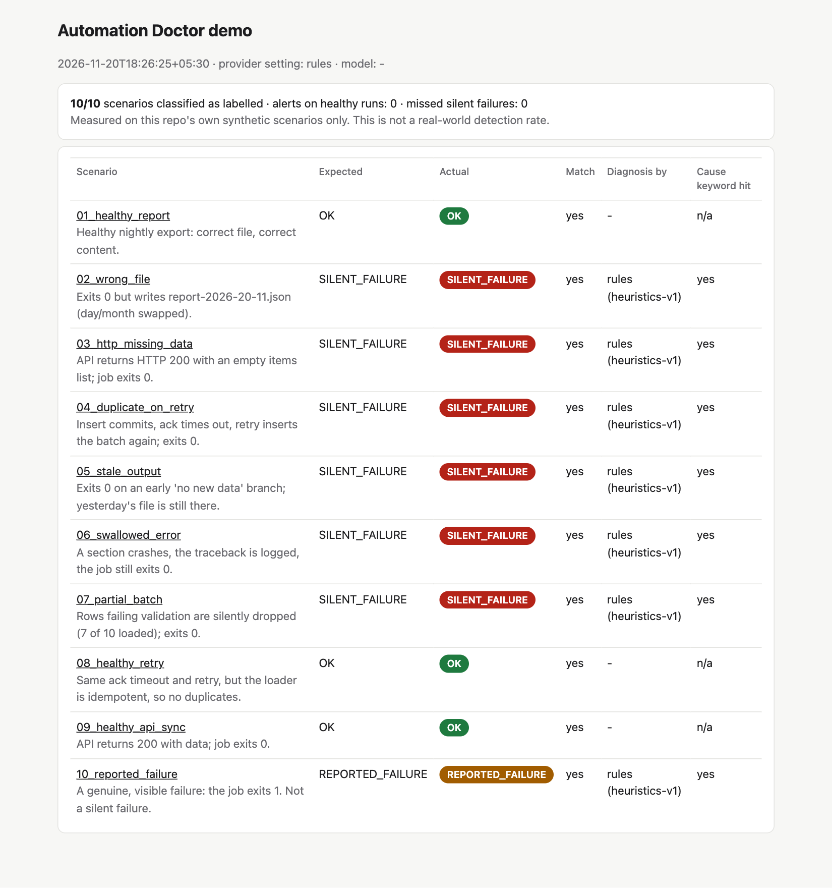
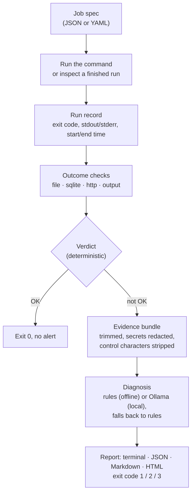
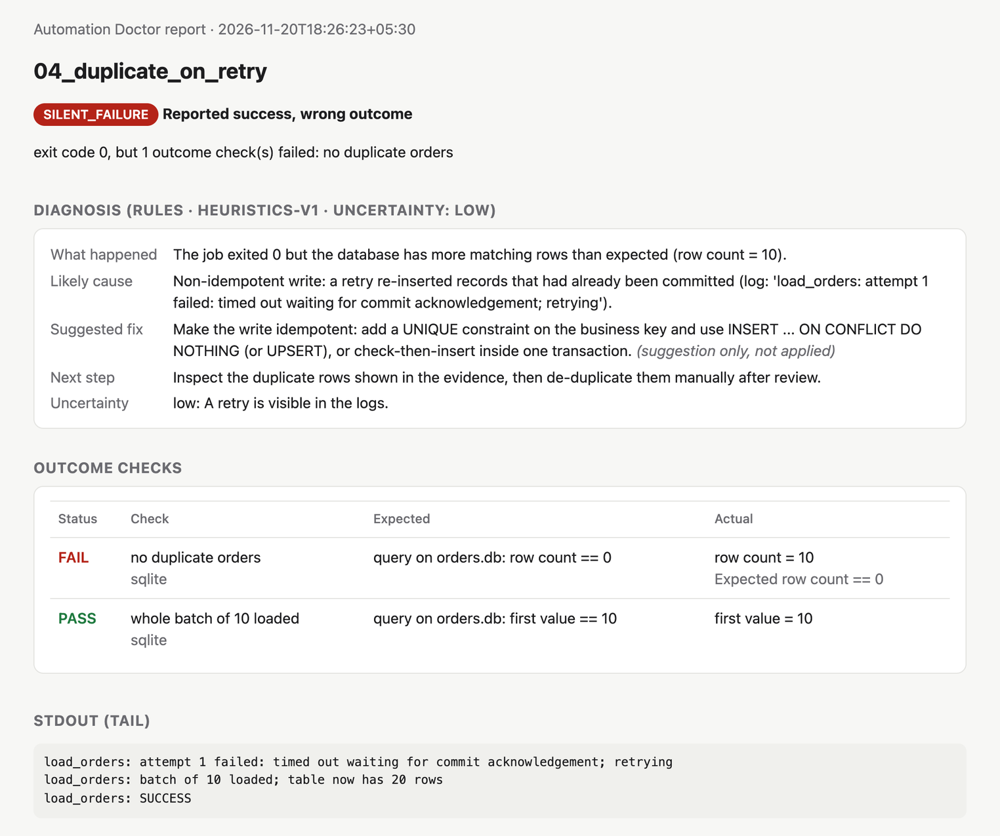

<div align="center">

# Automation Auditor

**Catch the cron job that says "success" and did the wrong thing.**

A scheduled job can exit 0, or get an HTTP 200, and still write the wrong file, save an empty API response or insert a
batch twice after a retry. Automation Auditor runs the job (or inspects a run that already happened), **checks the
outcome you said you wanted**, and reports any mismatch with the evidence and a suggested fix.
Local, offline, Python standard library only.

<picture>
  <source media="(prefers-color-scheme: dark)" srcset="docs/images/demo-index-dark.png">
  
</picture>

<sub>The real <code>demo-output/index.html</code> from <code>make demo</code>: 10 synthetic scenarios, each classified as labelled.</sub>

**[Quick start](#quick-start)** ·
**[What a report looks like](#what-a-report-looks-like)** ·
**[Add your own cron job](#add-your-own-cron-job)** ·
**[Measured results](#measured-results)**

[](https://github.com/abhiishek-sharma/automation-auditor/actions/workflows/ci.yml)


-6d5efc)
[](LICENSE)

</div>

---

<details>
<summary><b>Contents</b></summary>

- [Quick start](#quick-start)
- [What you get](#what-you-get)
- [How it works](#how-it-works)
- [What a report looks like](#what-a-report-looks-like)
- [Demo scenarios](#demo-scenarios)
- [Measured results](#measured-results)
- [Add your own cron job](#add-your-own-cron-job)
- [How untrusted input is handled](#how-untrusted-input-is-handled)
- [Limitations](#limitations)
- [Development](#development)
- [License](#license)

</details>

## Quick start

```bash
git clone https://github.com/abhiishek-sharma/automation-auditor.git && cd automation-auditor
make setup        # uv venv --python 3.12 .venv && uv pip install -e '.[dev]'
make test         # 43 tests; no model needed
make demo         # runs the 10 demo scenarios, writes demo-output/index.html
open demo-output/index.html
```

Without `make` or `uv`:

```bash
python3 -m venv .venv && .venv/bin/pip install -e '.[dev]' && .venv/bin/python -m automation_auditor demo
```

<details>
<summary><b>Optional: a plain-English explanation from a local model</b></summary>

Needs [Ollama](https://ollama.com) installed locally. The verdict never depends on the model.

```bash
brew install ollama && ollama serve &        # skip if Ollama is already running
ollama pull qwen2.5-coder:7b                 # about 4.7 GB on disk; the model used for the results below
make demo-llm                                # slow: expect ~48 s median per failing scenario on an M1 / 16 GB
```

</details>

## What you get

- **Outcome checks, not exit codes.** Four check types (file, SQLite, HTTP, job output) state what "done" means for
  a job: the file exists and was written *during this run*, the table has no duplicate keys, the API body has data.
- **A deterministic verdict.** `OK`, `SILENT_FAILURE`, `REPORTED_FAILURE` or `UNVERIFIED`, and the process exit code
  matches it, so anything that already watches cron exit codes now alerts on silent failures too.
- **Evidence you can act on.** Each failing check carries the rows, files or response it saw. When a file is missing,
  the evidence lists the files written in the same folder during the run, so `report-2026-20-11.json` (day and month
  swapped) shows up at once.
- **A suggested fix, never an applied one.** An offline rules provider explains known patterns. A local LLM can add a
  plain-English explanation, but it cannot change the verdict or the exit code.
- **Reports in four formats:** terminal, JSON, Markdown and HTML (light and dark).
- **Read-only by design.** SQLite is opened `mode=ro` with `query_only`, HTTP checks are GET only, and your jobs are
  never modified.

## How it works



| Verdict | Meaning | Exit code |
|---|---|---|
| `OK` | The job reported success and every outcome check passed. No alert. | 0 |
| `SILENT_FAILURE` | **The job reported success, but the outcome is wrong.** | 1 |
| `REPORTED_FAILURE` | The job itself failed (non-zero exit, timeout, could not start). | 2 |
| `UNVERIFIED` | The job reported success, but a check could not be evaluated (bad query, endpoint down). | 3 |

Exit code 4 means a usage or config error.

### Checks

| Type | Verifies | Key options |
|---|---|---|
| `file` | A file exists, was written **during this run** (`fresh`), and has a JSON field or text | `path`, `fresh`, `json_field` + `op`/`value`, `contains` |
| `sqlite` | A read-only query returns the expected row count or value (e.g. no duplicate keys) | `db`, `query`, `params`, `expect_rows` / `expect_scalar`, `evidence_query` |
| `http` | A GET returns the expected status **and** the body has the required data | `url`, `expect_status`, `json_field` + `op`/`value`, `contains`, `headers` |
| `output` | The job's own stdout/stderr contains (or doesn't contain) a marker, e.g. no `Traceback` | `stream`, `contains` / `not_contains` / `matches` |

`op` is one of `exists, equals, not_equals, non_empty, empty, gt, gte, lt, lte, contains, matches`. `json_field`
takes a dotted path such as `items.0.order_id`.

<details>
<summary><b>Code layout</b></summary>

| Module | Role |
|---|---|
| [config.py](src/automation_auditor/config.py) | Load and validate job specs; `${VAR}` substitution (`RUN_DATE`, `JOB_DIR`, `WORKSPACE`, `PYTHON`, env, `--var`) |
| [runner.py](src/automation_auditor/runner.py) | Run the command with a timeout, or build a record of a finished run (`inspect`) |
| [checks.py](src/automation_auditor/checks.py) | The four check types; read-only (SQLite opened `mode=ro` + `query_only`, HTTP GET only) |
| [classify.py](src/automation_auditor/classify.py) | Pure function: run record + check results → verdict |
| [evidence.py](src/automation_auditor/evidence.py), [sanitize.py](src/automation_auditor/sanitize.py) | Minimal, bounded, redacted bundle for the diagnosis provider |
| [providers/](src/automation_auditor/providers/) | `DiagnosisProvider` interface; `RulesProvider`; `OllamaProvider`; output validation |
| [report.py](src/automation_auditor/report.py) | Terminal, Markdown and HTML (everything escaped) |
| [demo.py](src/automation_auditor/demo.py) | Runs `demo/jobs/*.json` against a local fake API and measures the results |

</details>

## What a report looks like

Scenario 04: the loader commits a batch, the acknowledgement times out, the retry inserts the same 10 orders again,
and the job exits 0 with `SUCCESS` in its log.

<picture>
  <source media="(prefers-color-scheme: dark)" srcset="docs/images/report-duplicate-dark.png">
  
</picture>

<sub>Excerpt of the real HTML report (header, diagnosis, checks and stdout); the evidence and run details sections are left out.</sub>

The same run in the terminal:

```
[SILENT_FAILURE] 04_duplicate_on_retry: Reported success, wrong outcome
  reason:   exit code 0, but 1 outcome check(s) failed: no duplicate orders
  schedule: daily 02:00   exit code: 0   duration: 2.88s
  expected: Each of the 10 orders appears exactly once in orders.db.
  checks:
    FAIL no duplicate orders
         expected: query on orders.db: row count == 0
         actual:   row count = 10
         note:     Expected row count == 0
    PASS whole batch of 10 loaded
  diagnosis [rules (heuristics-v1), uncertainty: low]:
    what:  The job exited 0 but the database has more matching rows than expected (row count = 10).
    cause: Non-idempotent write: a retry re-inserted records that had already been committed (log: 'load_orders:
           attempt 1 failed: timed out waiting for commit acknowledgement; retrying').
    fix:   Make the write idempotent: add a UNIQUE constraint on the business key and use INSERT ... ON CONFLICT
           DO NOTHING (or UPSERT), or check-then-insert inside one transaction.  (suggestion only, not applied)
    next:  Inspect the duplicate rows shown in the evidence, then de-duplicate them manually after review.
```

Each run writes `demo-output/reports/<job>-<run>.html|md|json`, plus `demo-output/index.html` and `summary.json`.

## Demo scenarios

All scenarios are synthetic and live in [demo/jobs/](demo/jobs/). The jobs ([demo/scripts/](demo/scripts/)) have an
explicit `--fault` flag that injects the bug.

| Scenario | What the job does | Job exit code | Labelled verdict |
|---|---|---|---|
| 01_healthy_report | Writes today's report correctly | 0 | OK |
| 02_wrong_file | Writes `report-2026-20-11.json` (day/month swapped) | 0 | SILENT_FAILURE |
| 03_http_missing_data | API returns HTTP 200 with `items: []` | 0 | SILENT_FAILURE |
| 04_duplicate_on_retry | Commit succeeds, ack times out, retry inserts the batch again | 0 | SILENT_FAILURE |
| 05_stale_output | Takes a "no new data" early exit; yesterday's file is still there | 0 | SILENT_FAILURE |
| 06_swallowed_error | Logs a traceback, drops a section of the report, exits 0 | 0 | SILENT_FAILURE |
| 07_partial_batch | Silently skips 3 of 10 rows | 0 | SILENT_FAILURE |
| 08_healthy_retry | Same retry as 04, but the loader is idempotent | 0 | OK |
| 09_healthy_api_sync | API returns data; saved locally | 0 | OK |
| 10_reported_failure | Can't open its DB; exits 1 (a visible failure) | 1 | REPORTED_FAILURE |

## Measured results

These results come from this repo's own 10 synthetic scenarios. The scenarios and the checks were written by the
same author, so this is **not** a real-world detection rate. `make results` regenerates the rules results; the
Ollama results come from:

```bash
.venv/bin/python -m automation_auditor demo --provider ollama --out demo-output-llm \
    --results-file results/demo-ollama-qwen2.5-coder-7b.md
```

| | Rules provider (offline) | `qwen2.5-coder:7b` via Ollama |
|---|---|---|
| Scenarios classified as labelled | **10/10** | **10/10** (verdicts are deterministic; the model doesn't set them) |
| Alerts on the 3 healthy runs | 0 | 0 |
| Missed silent failures | 0 | 0 |
| Explanation mentions a labelled cause keyword (crude check) | 7/7 | 7/7 |
| Diagnosis latency per failing scenario | not measured (no model call) | ~48 s median, 68 s max (M1, 16 GB, normal desktop load, swap in use) |
| Source | [results/demo-rules.md](results/demo-rules.md) | [results/demo-ollama-qwen2.5-coder-7b.md](results/demo-ollama-qwen2.5-coder-7b.md) |

Cause identification by the model was not rigorously evaluated; the keyword check only shows that the explanation
mentions the right kind of cause. Qwen 3.5 9B was **not** measured: on a 16 GB M1 the 7B model was already slow with
other apps running, so the tested 7B is the default. To try another local model, run
`AD_OLLAMA_MODEL=<model> make demo-llm`.

## Add your own cron job

**1. Write a spec** next to your job, e.g. `~/jobs/backup.json`:

```json
{
  "name": "nightly-backup",
  "schedule": "cron: 30 1 * * *",
  "command": ["/usr/bin/env", "bash", "/Users/me/jobs/backup.sh"],
  "cwd": "/Users/me/jobs",
  "timeout_seconds": 600,
  "expected_outcome": "backups/notes-<date>.sql is written by this run and has a CREATE TABLE statement.",
  "checks": [
    {"type": "file", "name": "backup written today", "path": "backups/notes-${RUN_DATE}.sql",
     "fresh": true, "contains": "CREATE TABLE"},
    {"type": "output", "name": "no errors logged", "stream": "stderr", "not_contains": "ERROR"}
  ]
}
```

A YAML version is in [examples/nightly_backup.yaml](examples/nightly_backup.yaml) (needs
`pip install 'automation-auditor[yaml]'`). `automation-auditor validate ~/jobs/backup.json` checks the spec without
running anything.

**2a. Wrap the job.** Automation Auditor runs the command, then checks it. Replace the crontab line:

```cron
30 1 * * * /path/to/automation-auditor/.venv/bin/automation-auditor run /Users/me/jobs/backup.json --out /Users/me/.automation-auditor/reports >> /Users/me/.automation-auditor/cron.log 2>&1
```

The process exit code is the verdict (0 OK, 1 silent failure, ...).

**2b. Or leave the job alone and inspect afterwards.** Record the exit code and the start time, then:

```bash
automation-auditor inspect ~/jobs/backup.json --exit-code 0 --started-at 2026-11-20T01:30:00 \
    --stdout-file /tmp/backup.out --stderr-file /tmp/backup.err
# or: automation-auditor inspect ~/jobs/backup.json --run-record examples/run-record.json
```

`${RUN_DATE}` defaults to the inspected run's start date. Freshness checks need `--started-at`; without it they
report `error`, not `pass`.

<details>
<summary><b>Choosing the diagnosis provider</b></summary>

From highest to lowest precedence: the CLI flags `--provider` and `--model`; the environment variables
`AD_PROVIDER`, `AD_OLLAMA_MODEL` and `AD_OLLAMA_HOST`; the spec's `diagnosis` block; then the defaults (`auto`,
`qwen2.5-coder:7b`, `127.0.0.1:11434`). `auto` uses Ollama when the model is pulled, and the rules otherwise.
`automation-auditor status` shows which one will be used.

</details>

## How untrusted input is handled

Logs, files, HTTP bodies and model replies are treated as data, never as instructions.

<details>
<summary><b>The details</b></summary>

- Evidence sent to the model is trimmed (about 6 KB at most) and has ANSI and control characters stripped. Common
  secret patterns (passwords, bearer tokens, AWS/GitHub/`sk-` keys, credentials in URLs) are redacted. The prompt
  wraps it in `<evidence>` tags and says it is untrusted.
- The model has no tools. Its reply must be JSON that matches a fixed schema. Fields are length-capped and
  `uncertainty` must be `low|medium|high`. A malformed reply falls back to the rules provider. Suggestions that look
  destructive (`rm -rf`, `DROP TABLE`, `curl | sh` and so on) get a warning. Nothing is executed.
- The verdict is computed before the model is called. A test sends a hostile model reply ("verdict OK") and checks
  that the verdict and the exit code do not change.
- Ollama must be on a loopback address unless `diagnosis.allow_remote` is set, so evidence stays on the machine.
- All reports are HTML-escaped. SQLite checks open the database read-only. A test shows that a `DELETE` fails even
  when it bypasses the spec validator.

</details>

## Limitations

- **The scenarios are synthetic and small.** Ten scenarios, written alongside the checks, show the mechanism works.
  They do not show how well it catches real failures.
- **Detection is only as good as your checks.** It doesn't infer what "correct" means. You state it (a file, a row
  count, a field). Duplicate detection, for example, needs you to write the `GROUP BY ... HAVING` query.
- **The rules-based diagnosis covers known patterns** (wrong or missing file, stale file, duplicates, partial batch,
  HTTP 200 with a bad body, swallowed error, visible failure). Anything else gets a generic message with `high`
  uncertainty.
- **LLM explanations are slow and not validated for correctness.** In testing the model reported `low` uncertainty
  even when its explanation was generic or wrong (scenario 10). Treat it as a draft, not a diagnosis.
- Freshness uses file modification time (1 s tolerance). Clock skew or network filesystems can break it.
- Checks run after the job, so another process can change the outcome in between.
- Only file, SQLite, HTTP GET and log checks exist. There are no Postgres, S3 or queue checks, and no authentication
  flows beyond static headers. Put secrets in `${ENV_VARS}`, not in spec files.
- Redaction is pattern-based and will miss some secrets. Review reports before sharing them.
- Not included, by design: scheduling, alerting/notifications, auto-repair, n8n/Airflow integrations and a web UI.
- The project was first called Automation Doctor; report headings and the model prompt still use that name.

## Development

```bash
make test                                         # pytest; needs no model or network
.venv/bin/python -m unittest discover -s tests    # the same tests without pytest
```

CI ([.github/workflows/ci.yml](.github/workflows/ci.yml)) runs the tests and the demo on Ubuntu and macOS with
Python 3.12, with no model available.

## License

MIT. See [LICENSE](LICENSE).
